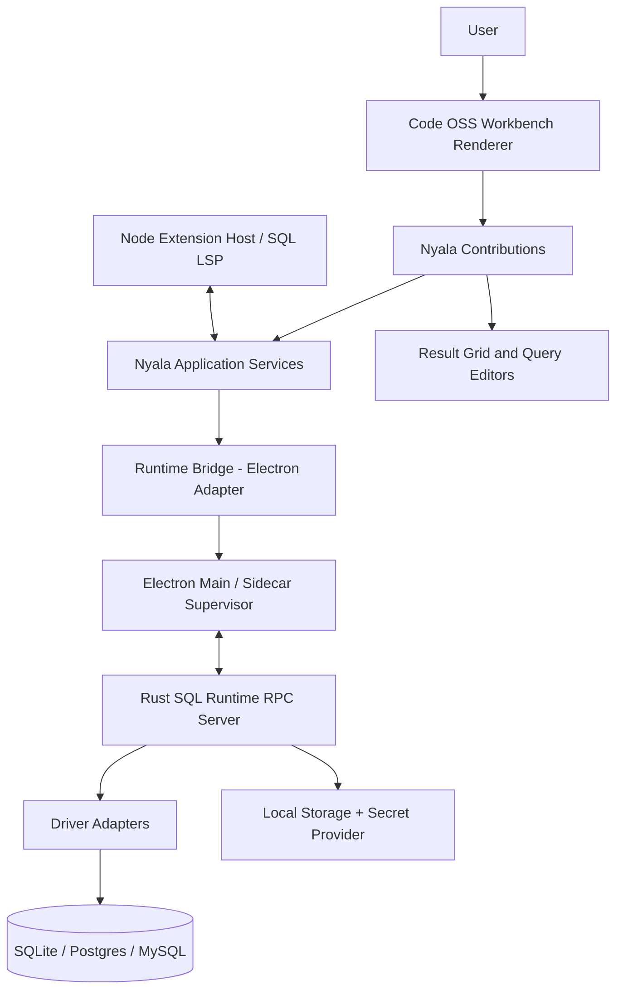

# 03 · 系统架构与模块边界

## 设计原则

- **Preserve upstream**：不修改 VS Code 核心来解决一个 Nyala Contribution 就能解决的问题。
- **One execution authority**：所有数据库执行通过 Rust Runtime；Extension 不能私自调用业务 SQL 驱动（但第三方 Node 扩展作为独立进程可拥有自身系统权限，这不是一个强安全沙箱）。
- **Runtime-neutral domain**：Rust 核心不感知 Electron/Tauri；运输层和 OS 集成可替换。
- **UI asynchronous**：Renderer 不直接阻塞读取数据库、持久化大结果或启动系统进程。
- **Explicit identity**：Profile/Session/Tab/Transaction/Execution/Result 均使用独立 ID，标注 Scope。
- **Recoverable failures**：连接断开、用户取消、Runtime 崩溃、失去权限都提供明确状态。

## 逻辑关系图



图是依赖与交互的抽象：真实安全边界由 Electron Sandbox、IPC 校验、OS 进程权限与数据库授权共同构成。

## 进程拓扑

| 进程 | 职责 | 不得负责 |
|---|---|---|
| Electron Main | 生命周期、窗口、Sidecar 监督、更新/对话框代理 | SQL 策略和结果缓存主体 |
| Workbench Renderer | UI 状态、Editor、Tree、Grid、Commands | 直接暴露密码/执行重 SQL |
| Extension Host (Node) | 扩展 API、语言服务代理、插件执行 | 绕过 Nyala 执行审批（对 Nyala 官方 API 而言） |
| Rust Sidecar | Connection/Transaction/Query/Cursor、Storage/Secrets 的受控服务端 | 操纵 Workbench DOM |
| LSP（可选独立进程） | SQL 语言分析、智能补全 | 持有任意写库权限 |

## 依赖方向

```text
Workbench UI
  -> Nyala Application Service Interfaces
    -> RuntimeBridge Interface
      -> Electron Bridge
        -> Sidecar Transport
          -> Rust Application Service
            -> Driver Capability Interface
              -> SQLite / Postgres / MySQL
```

跨层调用原则：Contributions 相互依赖时只通过公开 `common` 协议/Service；避免直接 Import 另一个 Contribution 的 `browser/*`。Rust Domain 不引用 Electron/Node/Tauri 包。

## 建议源码位置（逻辑路径，P0 根据 1.142.0 实际入口校验）

```text
src/vs/workbench/contrib/nyala/
  connections/browser/connections.contribution.ts
  connections/common/connections.ts
  queryEditor/{browser,common}/
  result/{browser,common}/
  bootstrap/browser/nyala.contribution.ts
src/vs/workbench/services/nyala/{common,browser}/   # 仅真正的跨 Contrib 服务
extensions/nyala-sql/                               # 稳定 Extension API 与语言
nyala/contracts/                                   # 版本化协议源码，构建时类型生成
rust/crates/{nyala-core,nyala-runtime,nyala-driver-sqlite,...}
```

增加原生服务前先查 Code OSS 对应的 service registration 与生命周期；在 1.142.0 上做最小例子，通过构建和启动确认再推广。不应臆测所有 API 在未来 Tag 相同。

## 建议核心服务接口

```ts
interface INyalaConnectionService {
  listProfiles(): Promise<ConnectionProfileSummary[]>;
  connect(profileId: string): Promise<SessionRef>;
  disconnect(sessionId: string): Promise<void>;
}
interface INyalaQueryService {
  execute(req: ExecuteRequest): Promise<ExecutionRef>;
  cancel(executionId: string): Promise<CancelAcknowledgement>;
}
interface INyalaResultService {
  fetchPage(resultId: string, cursor?: string, limit?: number): Promise<ResultPage>;
  release(resultId: string): Promise<void>;
}
```

上方是设计草案，不应独立于 `nyala/contracts` 再手写一套不一致的数据类型；以 Schema 生成结果替换。

## 独立 Identity 与生命周期

- Profile：持久的连接参数，不包含密码；凭证引用只指向 OS Secret。
- Session：连接池/实际后端句柄，可重建；带 `generation` 防止断线后的旧执行误归属。
- EditorContext：Tab 持久绑定 profileId 和当前可用 sessionId；切换必须可见，切换时处理运行中任务。
- Execution：不可重用的执行 ID 和状态序列号。
- Result：有过期时间/资源配额，释放后不能继续 Fetch。
- Transaction：绑定一个独占或已固定的物理连接，不允许连接池透明替换。

## 未来运行时替换边界

Tauri 实验允许改 `ElectronAdapter` 到 `TauriAdapter`，但还需另外适配 Workbench Electron 服务（菜单/窗口/原生进程/Extension Host/文件）。不能以“IPC 已抽象”为迁移完成标准。见 [18](18-experiments.md)。

## 架构反例

- 在 `sqlEditorPane.ts` 直接 `spawn('psql')` 或 `invoke('execute_sql')`。
- 用一个 mutable 全局 `currentConnection` 决定所有查询目标。
- 将 100 万行一次性 JSON 化后经 IPC 传给 Renderer。
- 扩展直接把用户数据上传给默认 AI 服务。
- 为“换肤”改动上游几十个 CSS 文件而没有公共主题层。
