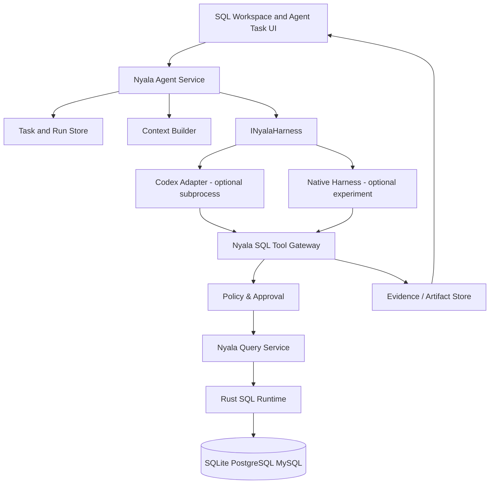

# 27 · Nyala Agent Platform：Harness 与工具编排架构（设计）

> v1.1 · 规划中，**不代表仓库已实现**。保留 ADR-0006：Agent 不进入 SQL MVP 的核心交付门槛。

## 1. 为什么不直接 Fork VS Code Chat

Nyala 的核心是 SQL Editor + Connection/Query/Result/Explain；通用 Coding Agent 对编辑文件、运行 Shell 体验较强，但缺少数据库 Session、Transaction、ResultHandle、SQL Artifact 的领域语义。复制上游 Chat 内部状态机将扩大上游补丁面，并增加 Code OSS Tag 升级成本。

**决策**：Workbench 中新增 Nyala 专有 Agent Service / Task View；Harness 通过独立 Host/Adapter 插拔，可从 Codex app-server 开始评估，不修改微软 Chat 核心。SQL Workspace 仍为默认专业入口。

## 2. 核心架构



`Agent Host` 与 `Rust SQL Runtime` 是独立生命周期的进程。Codex 的 Shell/File 权限与 Nyala SQL 权限是不同权限域；不得靠 MCP Tool 白名单就认定所有 Agent 操作受限，必须额外限制/审核通用 Shell/网络/文件能力。

## 3. 领域数据模型（规范概念，不锁实现语言）

- **Task**：目标、可见题目、connectionScope、风险级别、持久进度。
- **Session**：对话历史与上下文逻辑，绑定一个 Provider 和可恢复的 ContextSnapshot。
- **Run**：一次执行轮，具有 started/running/waitingApproval/completed/failed/cancelled/unknown 状态。
- **Event**：有 `eventId`、单调 sequence、runId、kind、timestamp、payload，能够去重和按序重建 Timeline。
- **ToolCall**：`toolCallId`、`taskId`、`runId`、`connectionScope`、`parametersDigest`、`deadline`、approvalId 与终态；写库请求不得以不确定网络/进程状态自动重放。
- **Artifact**：`artifactId`、type (`sqlProposal`, `explainPlan`, `resultRef`, `analysisReport`, `schemaDiff`)、来源证据、所有者、TTL；不能只保存 Markdown 文本。
- **Approval**：仅对固定工具名、目标库、参数摘要、风险级别、执行期限的一次性授权。

不要把 Codex `Thread/Turn/Item` 当成 Nyala 永久主键；适配器维护映射表，模型后端可迁移。

## 4. Harness Adapter API（草案）

```ts
interface INyalaHarness {
  readonly capabilities: Readonly<HarnessCapabilities>;
  initialize(config: HarnessConfig): Promise<void>;
  startSession(task: AgentTask): Promise<HarnessSessionRef>;
  run(session: HarnessSessionRef, input: AgentInput): AsyncIterable<HarnessEvent>;
  interrupt(runId: string): Promise<void>;
  resume(session: HarnessSessionRef): Promise<void>;
  respondToApproval(requestId: string, decision: ApprovalDecision): Promise<void>;
  dispose(): Promise<void>;
}
```

该示意类型不要求首次 PR 一次实现全部方法。`run` 是异步事件流，必须带 backpressure、最大事件缓冲、取消传播，未知事件类型可以降级记录而不使 UI Crash。拒绝模型循环无限执行：token、tool count、time、data bytes 四种预算单独限制。

## 5. Context Builder

最小数据：当前编辑器 SQL（经授权可上传）、选区、Connection Summary（脱敏）、已选 Schema、相关索引、限量 Plan 证据、数据库版本、SQL 执行耗时与错误。对外发送先形成 `ContextDisclosurePreview`，并记录 `sourceId`、采样时间、数据分类、已获授权范围。

默认不将完整 Schema、结果行、密码、连接串、生产环境样本发到远程模型。Schema 注释、表名、查询结果都属于不可信输入；与开发者指令和权限隔离。

## 6. 工具职责

第一波：`listConnectionsSafe`, `listSchemas`, `describeTable`, `getIndexes`, `proposeSql`, `saveArtifact`；静态 `EXPLAIN` 是否有副作用取决于数据库方言及 SQL，不能笼统归入无风险。读查询也必须 QueryService/DB 权限检查与结果/时间/外发限额。写 SQL 默认无执行通道。

将 MCP 视作可能的传输适配器，而不是权限授权系统。MCP Server 暴露受控 Gateway，不直接提供 DB 凭证或任意 SQL Driver 实例。

## 7. 进程、隐私、恢复

- IDE 启动不依赖 Codex 二进制或网络；Provider 不可用只影响 Agent Workspace。
- 独立 Agent Host 崩溃时对 Run 标记 interrupted/unknown，禁止自动重放具有副作用的工具。
- 权限审批由 Nyala UI 展示数据库身份/SQL 和范围，Policy Engine 再度验证；Token/凭证只进入 OS Secret 或安全进程，Renderer 和 telemetry 不记录明文。
- 发布前必须对代码签名、升级、回滚、依赖许可证及用户授权流程进行验证。

## 8. 第一轮实现切片建议

A0 完成 ADR + FakeHarness 事件模型 + Tool Gateway 接口草案；A1 首先手动指定 Codex 可执行文件做 App Server 进程连接原型（不要求自动下载）；A2 先完成 Task 展示和 SQL Artifact 跳转，再做复杂模型、插件市场或多 Agent。

## 9. 禁止过早扩张

不做通用 Coding Agent，不设计默认 Shell/System 访问，不做云 Agent、不接管 VS Code Chat、不让自研 Agent Loop 阻塞 P1/P2。一个可审查的 SQL Inspector 比十个没有隔离边界的 Agent 角色更有价值。
